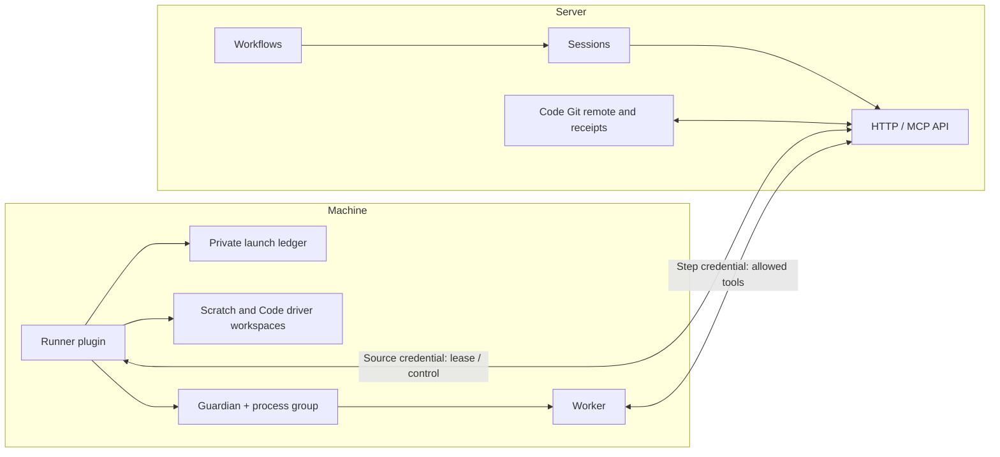

# Machine runner

The optional `@merv/runner` plugin runs on an agent machine. It polls Merv over
authenticated HTTP, receives one frozen workflow assignment, and starts a local
worker with that assignment's scoped MCP credential. Workflows still decides
the gate, context recipe and allowed operations. Sessions still owns admission,
leases, expiry and recovery. The runner executes those decisions.



These arrows describe communication, not Cordis injection. Runner has `inject: []`
and provides `ctx.runner`; it does not require the server State, API or Sessions
providers in its own process. Its SQLite ledger is private machine state. The
server's default configuration does not install it, and it adds no agent tools.
The server-side [Code service](CODE_OPERATIONS.md) serves native Git smart HTTP.
Runner uses bounded metadata requests for credentials, submissions and shutdown receipts.

## Running it

Copy [the example configuration](../config/runner.example.json) and set its
server URL, project, private local directory and installed executable. Export an
ordinary Merv actor credential or user-owned machine key under the named
`credentialEnv`, then run:

```sh
npm run cli -- runner --config /absolute/path/runner.json
```

The config contains the environment variable's name, never its secret value.
Directory and path-like executable names resolve relative to the config file.
Bare executable names use `PATH`; command arguments remain literal strings.
The CLI installs only the runner plugin and handles SIGINT/SIGTERM through its
Cordis disposer. Readiness includes an offline state if the server is unavailable.

A runner has no repository of its own: Git work comes through Code's `code.git.1`
driver, which `merv runner` always composes. Workflows
must declare their Git policy; assignments without one still use scratch.

Enable dispatch from the server's Sessions page. Default dispatch is off. Pause
prevents new assignments while preserving current workers. Halt closes leases;
the machine observes closure and stops their process groups. A source refusal on
runner control stops its workers immediately; a transient outage retains them
only until their last confirmed deadline. A single-session refusal stops that
session without revoking other sessions.

## Local launch profiles

| Profile   | Supported behavior                                                                                                                                                                |
| --------- | --------------------------------------------------------------------------------------------------------------------------------------------------------------------------------- |
| `codex`   | Native Codex CLI, frozen assignment on stdin, scoped MCP catalog, bounded local shell, read-only or assigned-workspace-write filesystem policy. Model and effort are optional.    |
| `claude`  | Claude Code headless (`stream-json`), the same frozen stdin and scoped MCP server, no user or project settings; a sealed review keeps only the read tools.                        |
| `command` | Trusted local executable plus literal argv, the same frozen stdin and MCP environment. Read-only leases are refused because this profile supplies no verified filesystem sandbox. |

Remote desired settings can enable/disable an existing profile and tune its
parallelism, model and effort. They cannot supply an executable, command
arguments, harness, environment variables or a new local profile. Responses are
checked against the requested project, session, runner and lifecycle state.

The source credential stays in the controller. Workers receive only their step
credential, and model-generated Codex shell commands do not inherit it. Native
profiles disable inherited rules, optional integrations and unrelated MCP
servers. This does not isolate hostile programs running as the same OS user;
see the [process and isolation contract](../packages/runner/README.md).

## Recovery and completion

Pending request identity is committed before requesting a lease. A lost reply
reuses the same request and derived secret. Launch identity is committed locally
and attached remotely before spawn. The guardian claims it once in SQLite.
After a controller crash, a replacement reconnects to that guardian instead of
starting a second worker. A second controller cannot acquire the same ledger.

A guardian has its own deadline and owns a live child handle. It never kills a
PID read from disk. Confirmed shutdown permits local capture. A Git launch keeps
its slot until result acknowledgment and checkout cleanup complete. If the
guardian is unreachable or cannot confirm termination, the launch remains
`uncertain`, consumes capacity and is not respawned—even if the server lease
has closed—until it is proven gone: claimed in an earlier boot, or with no
command pinned a minute after it was first found unreachable. Historical launch
and redacted log records remain inspectable.

A zero process exit code is not a completed workflow gate. If the agent exits
before its handoff, the runner releases unfinished work with a canonical failure
outcome; short exits use `crash_loop` so server backoff prevents tight retries.
Successful handoffs are established by durable workflow transitions. Release
reporting is retryable and happens only after local termination is confirmed.
Each ended launch makes one release call. A user's own stop of the runner
(Ctrl-C, systemd, an upgrade) releases the launches that stop ended with no
outcome, which counts against nothing. A hosted runner's stop, a halt after a
source refusal, a deadline, and an ending that merely raced the stop keep their
counted outcome. A refusal that asking again cannot change (any 4xx except 401,
408 and 429, and except the codes `transaction_conflict` and
`invalid_control_response`, which are retried whatever their status) is that call's answer: it is recorded once and never replayed, so a
session the server no longer knows is stopped once and settled.

An idle runner costs the server little. Presence is sent when it changes, 15 s
after the last accepted one (the server holds it fresh for 45 s) and at once
after a failure or a `settings_pending` decline, so remote settings apply within
15 s. A profile whose lease was declined is not asked for again for 5 s; a
request whose answer was lost is always replayed. Each live session is read every
tick, but heartbeated only for a slide the server keeps (15 minutes, or any slide
to its hard deadline), as judged by the runner's clock against the server's `expiresAt`: the
machine's clock is assumed to be within a minute or so of the server's, as the
local deadline check already assumes. A clock hours behind heartbeats only when
the session is that close to expiry, and one four hours behind never does. A
guardian's deadline is pushed only when its session's has moved on by more than a
minute, so a launch that activates late is extended on the first tick that sees
it active. A managed
runner's read does not reconcile its session on the server, so it learns of a
close that reconciling decides (an expiry, or a workflow moving on after a
handoff) up to about a minute later than a heartbeat every tick would.

The runner sets `MERV_USAGE_FILE` for each launched process: the path of `usage.json` in
that launch's private run directory, cleared before the process starts. A profile's
wrapper, or the process itself, may write one JSON object there:
`{"inputTokens": 0, "outputTokens": 0, "model": "name"}`, the model optional and nothing
else allowed but a legacy `costUsd`, which is accepted and dropped. Without that file the runner asks the launch's profile what its harness printed: the Codex
profile reads the `turn.completed` usage of its own `codex exec --json` stream from the
redacted `stdout.log` (input tokens, cached ones included, output tokens and the profile's
model, never a cost); the Claude profile reads the final `result` event of its
`stream-json` output (input tokens plus the cache it wrote and read, output tokens and the
profile's model; any cost it reports is dropped), or, for a run stopped before it, the sum of each
model call's usage; Claude's log is read whole, Codex's last 1 MiB from its first whole line.
Codex prints it only after the closing message it writes once the handoff tool returns, so a Codex launch whose own handoff closed its session gets a grace of
a minute, within its deadline, to exit by itself; any other close, and any other profile, is
stopped at once. The grace holds the launch's capacity slot but changes no capture: the
worker's tools are already closed, the final capture is still taken once the process has
ended, as a Git result submission already expects, and a sealed lease's Codex sandbox is
read-only. A Codex launch stopped before its turn completed still reports nothing, as does
any other profile that writes nothing. When the launch is over the runner sends a regular
file of at most 4 KB in that shape, or what the profile read: with its release when the
process ended first, and on its own when the server had already closed the session, which is
how a landed handoff ends. The ledger remembers that the report was answered, so it is
retried across restarts and sent once. The figures are a self-report from whatever could
write the file; see [usage and budgets](BUDGETS_AND_LIMITS.md).

Each launch that printed anything also delivers one redacted copy of its `stdout.log`, for
operators: it declares the file before each release try and, after its workspace result and
checkout close, PUTs it in the background to the object store through a signed URL Sessions
gives it. Nothing waits on the store, and a server without the route costs one call. See
[the runner README](../packages/runner/README.md#settling-an-ended-launch).

Sessions' source-owned `get` now reconciles current expiry and workflow admission
without activating work or rebuilding context. That lets the runner discover
closed or invalid assignments even when the child makes no further MCP calls.

## Workspace drivers and capabilities

The runner schedules, launches and reports through a generic driver interface. Current task, experiment and customer-experiment policies require Code's `code.git.1` driver, which needs Git but no local source repository or GitHub credential. A runner advertises its composed drivers; Sessions offers only compatible assignments. A launch records its driver so restart uses the same one. Historical `code.v2` definitions remain unchanged, but legacy work and runners must drain before native cutover.

When a driver cannot prepare because storage or transport is unavailable, the lease returns as `preparation_deferred` with its cause. This does not count as a failed launch or form a hold. A missing composed driver is also a deferral. See [workspaces](WORKSPACES.md) for admission and recovery.

## Git workspace lifecycle

Checkout intent is durable before Git preparation, and the stable launch ID and initial snapshot are attached before spawn. Writable workers use ordinary Git in their assigned branch. The server enforces scoped credentials, object admission and the current writer generation.

An ordinary session end confirms the producer has stopped, pushes any agent-created commits and closes the generation. It preserves dirty files for continuing work on that host without making a commit. A workflow submission instead freezes the stopped producer's exact tree and parent as retained Git objects. Independent review waits until those objects and their immutable receipt are durable. Review runs with read-only code and Git metadata, separate writable scratch and no producer credential; unsupported isolation refuses the launch.

A passing review journals an approved milestone. Reconciliation creates the exact approved commit, if needed, before admitting the next writer or exposing accepted code to dependencies. Planned VM teardown has a separate capture handshake: stop producers, settle submissions, commit remaining work if needed, push and verify, then acknowledge shutdown. Fleet cannot release the host before that receipt. Unexpected provider loss can lose files that were never transferred.

One immutable session result is reported under the original source authority. Identical retries survive lost replies and controller restart; closed sessions can receive their exact late result without reactivation. A persistent successor waits for result acknowledgement and cleanup. Read-only results preserve their complete attachment. Unknown process ownership and foreign or partial paths remain available for recovery.

## Supported scope and validation

Native Git transport, immutable submission review, approved milestone retention and planned shutdown capture are integrated. Session results are authenticated observations; Code separately verifies Git objects and Code Work verifies review authority. Neither a push nor a result advances managed main without its integration policy.

Pairing, source-key rotation for an existing ledger, an operational settings editor and additional native harnesses remain separate work. The ledger stays bound to its original source credential digest. A different key requires a new ledger until a verified rotation handoff exists.

Use `npm run test:runner` for synthetic process and HTTP tests. Hosted review isolation requires the Linux image gates described in [hosted runner operations](../scripts/hosted-runner/README.md). Native provider acceptance and production deployment are explicit operations.

The historical workspace-capture checkpoint passed all 490 repository tests, backend/UI typechecks
and builds. Native Git acceptance also passed on 2026-09-15 using the since-removed
local repository driver and `scripts/live-runner-workspace.ts`: exactly two fresh Codex agents completed a
synthetic managed `work → capture → verify → done` workflow on one machine. The
writer edited files, Runner captured the commit, and the read-only verifier
checked that frozen commit. The source stayed unchanged, both processes stopped,
and both workspace records closed. The report is
`/private/tmp/merv-native-git-live-20260915-02/report.json`.

That Git run predates Code operations and uses a generic verification gate and one private object store. It
does not establish actual Reviews/consolidation integration, central publication
or cross-machine transport. Synthetic Code integration now verifies live-worker
commit receipts, actual Reviews attribution and lost-response recovery. Native
Code acceptance is tracked separately in [CODE_OPERATIONS.md](CODE_OPERATIONS.md).
Consolidation, publication and transport remain separate parity work.
