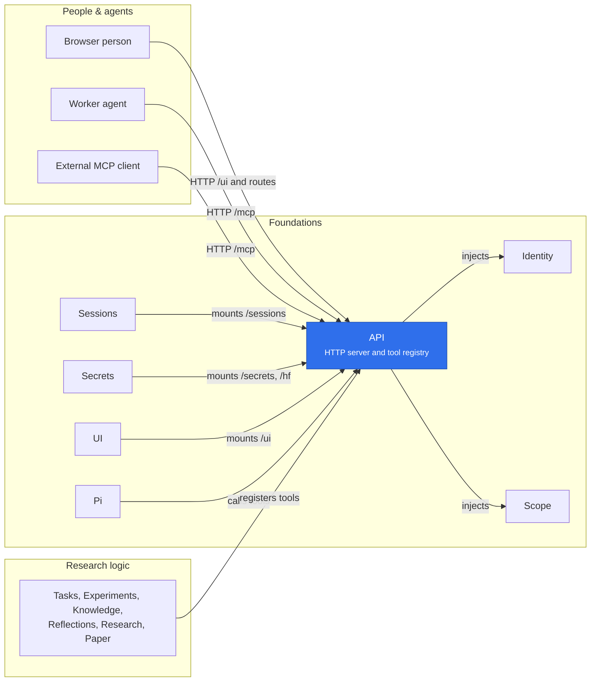

# @merv/api

Tools use [noun action envelopes](../../README.md#agent-tools):
`{"action":"x","x":{...}}`. `core` tools load up front; `deferred` tools are
available through discovery; `worker` tools serve leased sessions or scoped
profiles; `ui` tools serve pages. Discovery never replaces authorization.
Retired names execute as one-release aliases and are hidden from personal-agent
lists. Leased workers retain their pinned names and inputs; no published workflow,
policy or recipe changes in this cutover.

Merv's front door. The package holds two plugins: `@merv/api/tools-plugin` (config row `tools`) injects `scope` and provides `tools`, the registry every plugin registers its tools in; `@merv/api` (config row `api`) injects `scope`, `tools` and `identity` and provides `api`, the HTTP server. The server answers `/health`, `/auth/config`, `/tools` and `/mcp` itself, and other plugins mount their own routes on it. Read-only tools run in a State snapshot when State is loaded. Each tool call takes one Scope decision, right before its handler: a read's inside its snapshot, a mounted tool's as its grant check, a worker session's as its admission. An open-world read is also decided after its handler, so a revocation while it waited withholds its result. A listing (`GET /tools`, MCP `tools/list`) likewise takes its caller's one decision in the registry.

## Where it sits

People and agents reach Merv only through the API: Identity verifies a browser's token and Scope decides what each caller may do. Plugins plug in by mounting routes and registering tools, and the same registry serves `/mcp`, `/tools` and Pi's in-process calls.

## Surface

- HTTP: `/health` and `/auth/config` (public), `/tools`, and the MCP endpoint `/mcp`.
- `ctx.api`: `mount(prefix, handler)`, `credential(namespace, …)`, `start`, `stop`. `stop` keeps serving while the requests in flight when it began finish (up to `drainMs`, 45 s), so a restart fails callers only for as long as the process is down; it then answers every new request 503 `unavailable` ("Merv is restarting and did not run this request; retry it in a minute") and cuts, within two seconds, whatever is still open, after letting a tool call still running finish and send its reply.
- `ctx.tools`: `register`, `list`, `call`, `invoke`, `registerSessionPolicy`, `registerCallerRules`, `contributeInstructions`, `contributeContext`.
