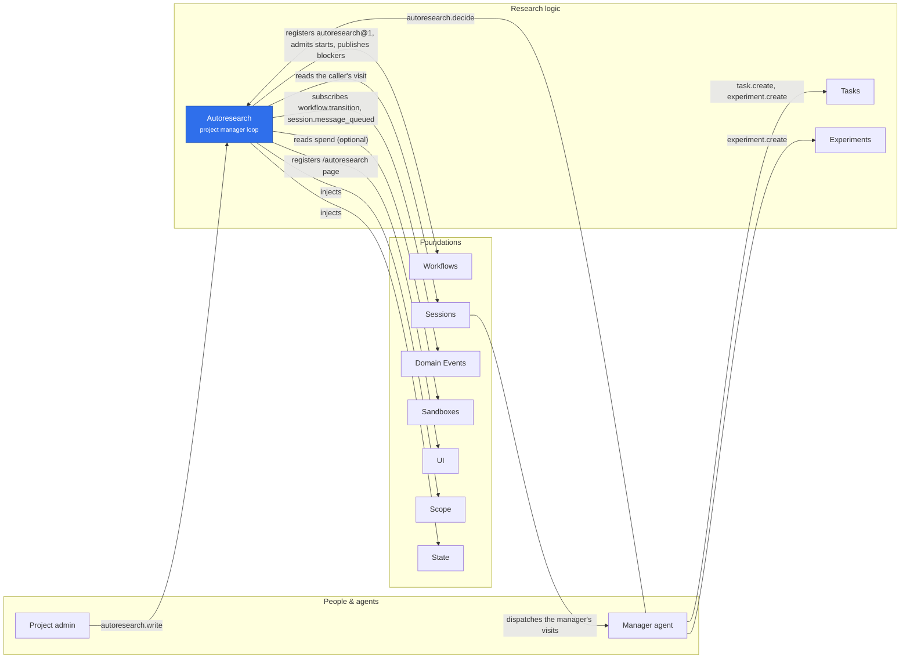

# @merv/autoresearch

Personal-agent tools below use `{"action":"x","x":{...}}`.
See the [tool overview](../../README.md#agent-tools).

A manager agent per research project. It is a Sessions worker on the project's `autoresearch@1`
instance, woken when a task or experiment it started ends. It schedules the next work through
the ordinary task and experiment tools, within a spend cap, asks the person only for real
decisions, and pauses for them at the cap and after a run of automatic wakes. Off by default.
See [Autoresearch](../../docs/AUTORESEARCH.md).

## Where it sits

Autoresearch imports nothing of Tasks or Experiments: it sees their starts through Workflows'
start admission and their ends through `workflow.transition`. Sandboxes is read through
`ctx.get` when loaded; without it, or without a linked namespace, nothing spends.

## Surface

- `@merv/autoresearch`: the `autoresearch` service. It registers `autoresearch@1` and a start
  admission with Workflows, and consumes `workflow.transition`, `session.message_queued` and
  its own `autoresearch.reconcile` events (`autoresearch.wakes.v1`).
- `@merv/autoresearch/tools`: `autoresearch.read` (status), `autoresearch.write` (configure,
  pause, resume, start_round, end_round; people only) and the worker tool `autoresearch.decide`,
  granted only to the manager's own instance and revision.
- `@merv/autoresearch/ui`: the `/autoresearch` page and its part of `ui.home`. Its `needs`
  places the manager's cap and wake-limit pauses in Needs you.
