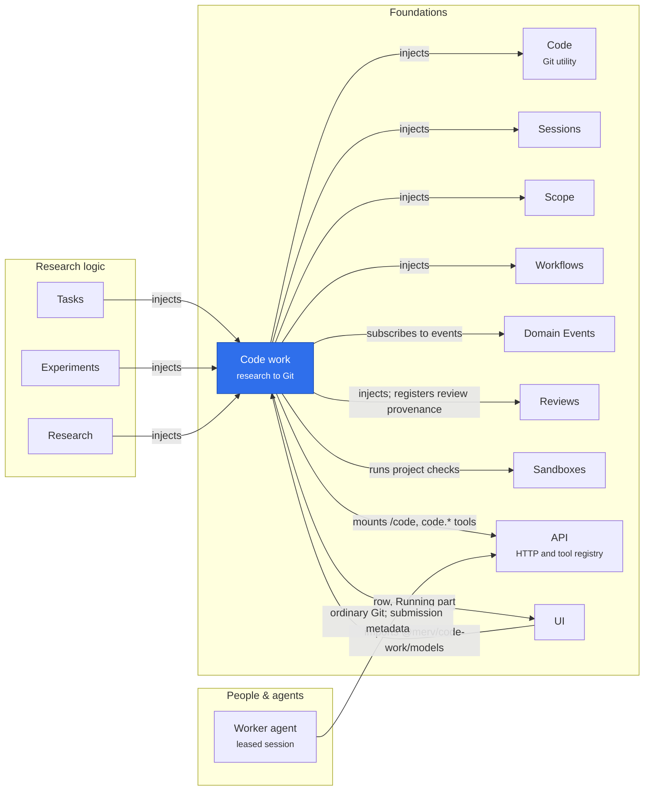

# Code work integration

Personal agents use `code.read` (files, log, status, unit, operation) and `code.write`
(base controls, repository preparation/configuration, unit fencing and local integration), with the [noun action envelope](../../README.md#agent-tools).
Workers use ordinary Git through their assigned origin remote. Local bind and repository rebind
were removed; `repository_prepare` integrates a selected branch already pushed to Merv.

This adapter connects research decisions to the [Code utility](../code/README.md).
Research owners decide dependencies, accepted outcomes, review requirements and publication
obligations. The adapter translates those decisions into exact code pins, retained evidence,
dependency blockers, conflict-resolution work and publication operations.
It never makes Code itself depend on a research service.

It provides `ctx.codeWork`; Tasks, Experiments, Research and Knowledge require it. It requires
Reviews, which every acceptance and publication reads; Sandboxes is an optional collaborator. A
missing plugin never grants acceptance or erases an existing Git obligation.

| Module                  | Dependencies    | Interface                                                           |
| ----------------------- | --------------- | ------------------------------------------------------------------- |
| `@merv/code-work/tools` | CodeWork, Tools | `code.read`, `code.write` and runner metadata                       |
| `@merv/code-work/ui`    | CodeWork, UI    | Repository, selected base, retained operations, Home's person moves |
| `@merv/code-work/api`   | CodeWork, API   | The `/code/*` authenticated machine routes                          |

The API adapter mounts authenticated `/code` controls and the ordinary smart Git HTTP remote at `/git/<projectId>.git`. A user key is the Git password; clone and fetch require project read access, and pushing user branches requires project administration. Merv reserves `merv-main` and `merv/*` branches. Unloading CodeWork withdraws those routes, which then answer 503, without stopping the API.

## Where it sits

Code work is the one bridge between research decisions and Git: Tasks, Experiments and Research bind to it when it is present, and it alone drives Code. Through Domain Events it initializes each new project and reconciles research state on every workflow transition; Code itself opens and ends a session's writer generation as its workspace attaches and closes.

## Composition

Every composition loads Code and CodeWork: Tasks, Experiments, Knowledge and Research require
CodeWork, and CodeWork requires Code and Reviews. Code builds its repository journal;
CodeWork opens them with its callbacks (what imported history or a binding or writer change
changes, which sessions hold a workspace) and runs imports and the `/code/v2` workspace protocol on them.

A pushed user branch and the research baseline are separate. An administrator selects a
retained branch and exact head for `repository_prepare`; independent review integrates both
histories before the baseline advances. Every running unit keeps its original starting commit.
The user's own agent handles GitHub. Merv retains historical publication and review evidence,
but performs no external import, mirroring or publication.

Its `mainLanding` setting (`MERV_CODE_MAIN_LANDING`) lands accepted work on the local research baseline. Several accepted commits are always merged into one base on the server.

Review provenance is read through the Reviews service rather than its private tables.

The adapter owns research unit declarations, dependency-derived pins, acceptance bodies and
hashes, reviewed rounds, resolution provenance, and publication obligations. Its records
compose Code's generic workspace and retained-commit API; Code receives commit identities
and durable repository holds, without interpreting research workflow state. The unit policy
holds its durable records rather than extending them, and reads each unit through them with
its publication enforcement and derived base. `@merv/code-work/models` holds the portable read
models, among them publications and capture refs, which the browser and Experiments import.

See the [ownership boundary and upgrade behavior](../../docs/CODE_WORK_BOUNDARY.md).

## Submitted trees and approved commits

Experiment 45 and task 46/47 submit the current producer session, then wait for that
process to stop. The runner retains a Git tree object and its parent history under
immutable submission refs and posts the stopped-writer receipt. This creates no
commit. Review dispatch waits for the receipt; its isolated checkout has the
submitted parent as HEAD and the exact submitted tree as its working files. Both
code and Git metadata are read-only; test outputs belong in separate scratch.

A passing review and its milestone intent are recorded in the same database
transaction. Journal reconciliation then creates a deterministic commit for the
reviewed tree, retaining the parent commit if the tree is unchanged. Retrying after
a lost acknowledgement reuses the same immutable approval ref. Only after that
Git retention succeeds does Code record accepted code and make it available to
dependents. Plan approval advances the work branch and gates the next writer in
the same way without marking the whole experiment accepted. Rejected reviews do
not create commits. Agent-created commits and pushes remain ordinary Git actions.

An ordinary session end closes its writer generation without a commit. A machine
that remains alive keeps the unit's working files for its next assignment.
Approved milestone retries never snapshot a working directory. The deployment
preflight in `src/cutover.ts` requires active ownership and transfers to drain.
The explicit offline migration preserves eligible idle work and retains the exact pending
artifact-only review. New producer leases refuse unmigrated legacy versions; published
protocols and Code declaration provenance are never rewritten.
