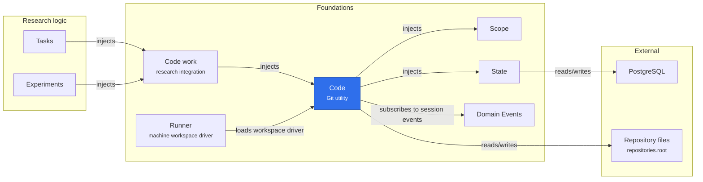

# Code

Code is the Git utility. It retains exact commits, project repository bindings,
workspace inputs and writer generations; owns repository files and Git
execution; and serves the authenticated project Git remote. It depends only on
**State, Scope and Domain Events**: it follows session attach and close events to open and end
writer generations (subscription `code.writers.v1`). It does not load Workflows, Reviews,
Sessions, or research policies.

The core service is `ctx.code`. Its repository, workspace and writer APIs are technical building
blocks. Callers retain commits under opaque keys and pin workspace inputs inside their own
transaction. Retention keys preserve every commit across repository transfers and rebinding.
Core checks integrity and concurrency; it does not decide research acceptance, scheduling,
review requirements, or which experiment's work belongs in a project.

The [Code work integration](../code-work/README.md) provides those connections
and the user-facing tools, machine API and UI. Tasks, Experiments, Knowledge and Research
require it, so every composition that loads them loads both plugins. The user’s own agent manages any external remote.

## Where it sits

Code sits at the bottom of the Git path: only Code work injects it, and research plugins reach Git through Code work, never through Code. The browser reaches Code's store types only through Code work's models. Code keeps the facts, the repository files and transport; whether a commit is accepted is decided above it.

## Composition and ownership

| Component          | Responsibilities                                                                                   | Required services                                               |
| ------------------ | -------------------------------------------------------------------------------------------------- | --------------------------------------------------------------- |
| `@merv/code`       | Repository ownership, retained Git facts, fencing, Git transport                                   | State, Scope, Domain Events                                     |
| `@merv/code-work`  | Research dependencies, evidence, review provenance, workspace handoff and publication coordination | Code, State, Scope, Sessions, Workflows, Reviews, Domain Events |
| Code work adapters | `code.read`, `code.write`, `/git/*` remote, `/code/*` controls and Code UI                         | CodeWork plus Tools, API or UI                                  |

The utility owns repository locks and Git transport. The integration releases its own
operations when unloaded. Technical changes to bindings and writers reach the integration
through the `changed` callback it lends at `openStore`, within the same transaction; failure
rolls back both the fact and projection.
Unloading a projection never deletes facts. Persistent repository holds preserve transfer
and rebinding restrictions when an integration is unloaded. Reattachment rebuilds derived
research state.

`repositories.root`, `quotaBytes` and `reservedFreeBytes` belong to the core configuration.
The writer grace (900 s; tests pass `finalizeGraceSeconds` to the constructor) also belongs to
Code, so every writer uses the same timeout.
Code builds the repository journal, and the integration opens them with
`openStore`, lending the callbacks only it can answer, and closes it when it unloads.
Historical operation recovery (every 300 s) and drain timing (45 s) run on
Code's defaults; only automatic base merging is the integration's to switch off. Disaster backup and restoration belong to
[deployment operations](../../docs/RECOVERY_SNAPSHOTS.md), outside both plugins. Historical migration text and retained workflow evidence remain unchanged. A separate generic
storage migration creates technical workspace, commit retention and repository hold records;
standalone Code never interprets acceptance or reviews.

Code owns the [store protocol](src/store/protocol.ts) (`@merv/code/store/protocol`): what Code
itself parses (the import, rebind, upload fence, fence inputs and the workspace
manifest), the store and writer statuses, and their size limits. The machine routes'
own bodies and the repository preparation belong to Code work.

## Standard Git remote

`/git/<projectId>.git` serves native smart HTTP through `git http-backend`. A user
supplies an existing Merv user key as the Basic authentication
password; any nonempty username works. Project administrators may push ordinary named
branches. `merv`, `merv/*`, `merv-main`, `merv-main/*`, and retained refs are server
controlled. Deletion and non-fast-forward updates are refused. An existing ref that
blocks a reserved namespace returns `409 code_ref_collision`, naming the ref and its
object ID before aliases change. A repository administrator must explicitly move that
history to an unused, non-reserved branch; the remote never renames or deletes it.
See the [operator recovery example](../../docs/CODE_OPERATIONS.md#remote-and-authentication).

The workspace control API issues separate runner and agent capabilities. Agent access
permits the assigned work branch only; reviewer access permits fetch only. Credentials
are passed through environment Git configuration and never written into checkout
configuration. Every request checks current authority, session identity, and writer
generation. Planned shutdown has a separate capability for the stopped last writer;
managed shutdown acknowledgement invalidates it.

Native Git receives directly into the project repository using its object quarantine.
Server-owned hooks validate refs and new objects with the shared admission policy,
and check the writer fence before Git commits its ref transaction.
Ordinary successful pushes become visible immediately. Merv reconciles the native outcome
into workspace metadata before returning the push reply; it never replays a refused push
as a separate ref update. A retained FIFO proves the receiver has exited after a server
restart. An unresolved outcome keeps that writer fenced until reconciliation completes.
Existing internal work refs and retained history remain available.

Frozen submissions retain their exact parent commit and raw tree under immutable
session refs without creating a commit. Approval materializes that tree once. A verified
same-session shutdown capture may supply the existing approval commit. Closing an
ordinary session preserves uncommitted files and does not create a commit.

The machine [Code workspace driver](src/driver/index.ts) supports isolated checkouts and
cross-machine handoff. The [Runner](../runner/README.md) CLI always loads it. It is the only driver: the
former local repository driver, for a runner with a repository of its own, was removed.

See [Code operations](../../docs/CODE_OPERATIONS.md),
[GitHub retirement](../../docs/GITHUB_REPOSITORIES.md), and the
[ownership boundary and upgrade behavior](../../docs/CODE_WORK_BOUNDARY.md).
