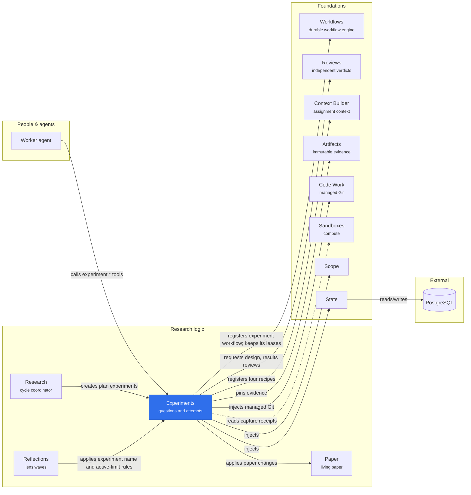

# Experiments

Personal-agent tools below use `{"action":"x","x":{...}}`.
Leased workers keep the alias names and inputs granted by their pinned workflows.
See the [tool overview](../../README.md#agent-tools).

Experiments owns research questions, attempts, evidence selections and the two
independent review gates. It registers three current contracts, `experiment@42` for new experiments (it adds `nisa.research`) and `experiment@41` and `@40` for those pinned to them, on which Sessions attaches Sandboxes compute. Each grants the large-upload tools, which refuse where the blob store cannot sign uploads; the upload-less twin `experiment@36` is retired. Their numeric versions identify immutable implementation contracts, not experiment attempt numbers. Four context recipes, `EXPERIMENT_RECIPES`, describe planning, design review, execution and results review. The retired `experiment.plan@1` and `@2` stay in `context_recipes` as history; their packages were deleted with their work items.

## Where it sits



Experiments carries a research question through planning, a run and two independent reviews on its own `experiment` workflow. Those reviewers' paper changes land in Methods and Results through Paper, and Research creates the experiments an approved reflection plan names; dotted arrows are optional bindings.

Other stored versions remain read-only history. Their attempts, submissions, evidence, verdicts and pinned workflow graphs are retained, but their old runtime implementations are not registered. They cannot dispatch, accept attachments or transitions, or acquire new review claims, and they do not occupy a current execution slot. No old record is upgraded into another contract. Creating a current experiment starts planning; it does not launch a process or decide whether a scientific claim is true.

| Entrypoint                | Requires                                                                       | Provides                                                        |
| ------------------------- | ------------------------------------------------------------------------------ | --------------------------------------------------------------- |
| `@merv/experiments`       | State, Scope, Artifacts, Workflows, Reviews, Context Builder, Paper, Code Work | `experiments` service and owned workflow/context/review routing |
| `@merv/experiments/tools` | Experiments, Tools                                                             | `experiment.read`, `experiment.write`                           |
| `@merv/experiments/ui`    | Experiments, UI                                                                | Experiment inventory and detail page                            |

The tools are `experiment.read` (list, get, exhibit) and `experiment.write` (create, attach, transition).
Current gates and next actions come from
`workflow.read` (`status`); assigned context comes from `workflow.read` (`assignment`).
Independent reviewers claim and submit through the existing `review.write` (`start`) and
`review.write` (`submit`) tools.

Experiments owns no compute. It records `computeEpoch` (`attempt:state`) in the workflow data,
and Sessions issues Sandboxes connections for eligible leased assignments. Compute profiles remain Merv policy:
`execute` while running, `check` for brief verification; sealed reviews receive no connection. The runner adds
guidance only after issuance. Captures and refusals come from Artifacts' Merv-side receipt index, filtered by
this attempt's compute epochs. Shared Sandboxes services are read outside Merv transactions.

```text
planned → design_review → running → experiment_review → complete
              │                         │
              └── planned               ├── planned (new attempt)
                  (new attempt)         └── running (same attempt)
```

Both `needs_changes` and `fail` are review returns. Design rejection permits
only `planned`, which may be omitted. A negative attempt review must explicitly
choose `returnTo: "planned"` or `"running"`. A pass must omit `returnTo`.
Owner actions `abandon` and `mark_failed` are separate terminal transitions and
require a reason. `retry_running` preserves the attempt, exact approved plan
and first execution start.

Mutations use strict schemas and actor/project-scoped request receipts. Attach
also requires the current `attemptIndex`; attach and transition require
`expectedRevision`. Repeating the same normalized request returns its original
committed response, while changed input conflicts. Current Scope authority is
required even for replay. Records, events and receipts compose in one State
transaction, including the owned review transition.

Evidence is retained through Artifacts before attachment. Planning accepts
`plan` and `feasibility`; execution accepts `result` and `report`. Each plan, feasibility
statement, report and JSON result is nonempty UTF-8, at most 64,000 bytes; a qualitative
result is referenced without being read, so a checkpoint or an archive of any retained size
is attached that way. Draft document sections may be unfinished,
but included figures must already resolve to scoped retained image artifacts.
Results explicitly distinguish finite JSON from qualitative text. Submission
and exit guidance share the same document/exhibit gates; guidance creates
no evidence or events. The generated exhibit and sealed review selections are
immutable.

Sessions consumes the program's generic lease hooks. Experiments registers its continuity key with Sessions and has no direct Runner dependency. A lease freezes context, the Project Introduction, recovery associations, figures,
prior assessments and artifact grants. The replacement
worker may reuse exact retained result inputs, but must author its own
verified plan or report. Ordinary owner production is blocked while a worker
owns that revision. Review independence uses the actual producing and reviewing
actors; two independent worker leases may have the same delegation source.

The optional UI shows state, attempts, evidence, approved plan, review history,
guidance and a metrics preview. Production mutations
remain available through tools. Feed can display committed experiment events
without being a dependency. Unloading the provider withdraws its routing,
workflow/context registrations and dependent adapters; durable records remain.

```text
packages/experiments/
├── package.json
├── README.md
└── src/
    ├── index.ts              # Service: records, review routing, Running board; binds the commands
    ├── program.ts            # Workflow graph, versions, evidence roles and compute epochs
    ├── definitions.ts        # Context recipes and review criteria
    ├── execution-policy.ts   # The tools each assignment is granted
    ├── context.ts            # Frozen inputs, references and the rendered assignment context
    ├── lease.ts              # Lease reads, roles and hooks
    ├── policy.ts             # Registration, the workflow policy, guards and review checks
    ├── commands.ts           # create, attach, transition, exhibit, submitReview and evidence sealing
    ├── program.postgres.ts   # Published lease-table migrations, through their move into wf_leases
    ├── storage.ts            # Owned table rows and migration registration
    ├── storage.postgres.ts   # Published record-table migrations
    ├── models.ts             # Record and command DTOs
    ├── types.ts              # Service contract and Cordis capability
    ├── input.ts              # Strict shared tool/core schemas and safe JSON boundary
    ├── evidence.ts           # Document, figure and metrics validation
    ├── running.ts            # Running page cards and sidebars
    ├── tools.ts              # Experiment tool registrations
    └── ui.ts                 # Optional UI registration
```

Knowledge now owns metadata inventory, exact reference resolution and immutable
terminal corpus capture. Reflection waves and code consolidation remain separate
implementation work.
This program does not publish code.

New experiments (`experiment@45`) use native Git on the assigned work branch. Planning and execution keep a writable checkout. Submitting a plan or results stops the producer and freezes its exact tree and parent without making a commit. An independent reviewer mounts that immutable tree with read-only Git metadata and an external scratch directory. A passing review durably journals the approval; Code retains the exact approved tree as a commit before admitting another writer or exposing accepted results to dependent work. Rejected submissions remain immutable evidence and do not create approval commits. Earlier published versions remain readable and must drain on the previous runtime before cutover. See [Always-on Git](../../docs/ALWAYS_GIT.md).

### Producer continuity (experiment@44)

New experiments use one producer thread across planning, execution, rejected-design rework,
execution repair and later attempts. Versions 40–43 keep their separate planning/execution
keys; existing conversations are never merged. Each visit gets a new lease, credential,
frozen grants and stage-specific workspace. On version 44 planning remains read-only;
version 45 planning and execution share the persistent writable work branch. Reviewers remain separate, with a fresh thread per review round.

Execution's current assignment names the exact approved submission and review, includes the
approval findings, and instructs the producer to follow the pinned plan, feasibility limits,
current workspace and deliverables. Current authoritative records supersede earlier conversation.
The UI attributes each visit to its actual stage even when the producer spans both stages.

A transition can close the session before the runner saves its conversation. Experiment
producer offers wait up to 60 seconds after an attached visit closes for its latest snapshot
upload; this is an uncounted retry, not a dispatch failure. After that bound the existing
fallback applies: use the last available snapshot, or start fresh if none exists. Restoration
is best-effort and harness-specific (Claude/Codex); a changed harness, failed upload/download,
invalid snapshot, changed delegation source, or a dormant thread expired after 14 days can
prevent resumption. This preserves history when available, not a guarantee of process or
model identity. The runner still captures after process exit and before resetting its home.
