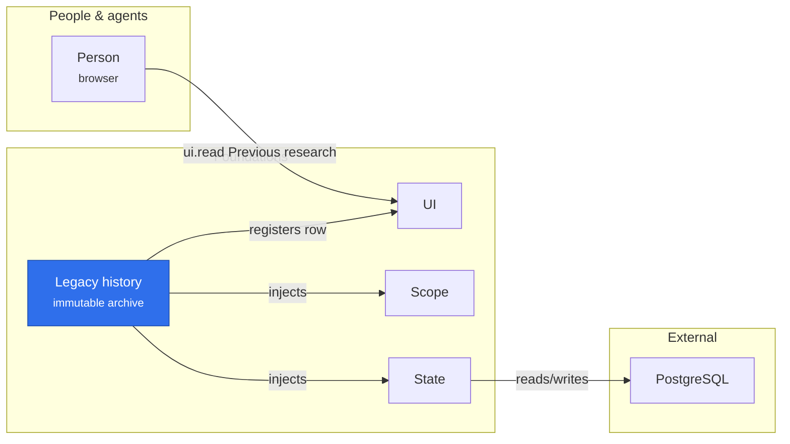

# @merv/legacy-history

Legacy history is the read-only archive of research imported from the previous server: its projects, claims, experiments, tasks, reflections, papers, artifacts, reviews, feed posts, workflow history and the other records of that schema. Its tables refuse every update and delete, and it offers no live workflow. The core injects `state` and `scope` and provides `legacyHistory`; its UI adapter shows one imported source as the Previous research page. Its separate tools adapter exposes the deferred, read-only `history.read` to agents, readers and scripts. The deployment composes all three only when `MERV_TS_LEGACY_SOURCE_ID` names that source.

## Where it sits

Legacy history stands apart from the live research plugins: its own UI and tools adapters expose the Previous research row and `history.read`, both checked by Scope against the caller's project.

## Surface

- Tool (`@merv/legacy-history/tools`): `history.read` with `summary`, `list` and `get`, using arguments under the action name (for example, `{ action: 'get', get: { type: 'experiments', id } }`). It is available through `script.tools`.

- Service `ctx.legacyHistory`: `summary`, `list` and `detail` for one imported source.
- Row (`@merv/legacy-history/ui`): `legacy-history` at `/legacy-history`, shown when the project has records. Its `ui.read` takes `{ action: 'summary' }`, `{ action: 'list', type }` or `{ action: 'detail', type, id }`; a detail adds links to the record's media files.
