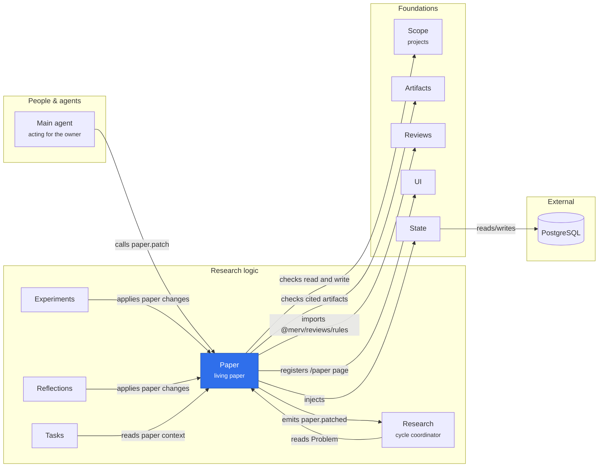

# @merv/paper

Paper stores the living project paper: four documents, Problem, Literature, Methods and Results, with citations and immutable revision history. It creates no workflow, assignment or lease. The owner's main agent edits any document with `paper.patch`; scientific reviewers in Experiments and Reflections land their Methods and Results changes inside their own review transaction. The Problem is the source of the project Introduction that every assignment carries. An edit made against an earlier document revision is merged with the edits made since, line by line, unless both changed the same lines (`merge.ts`); only then is it refused as a revision conflict that names the sections to read again. See [Living paper](../../docs/LIVING_PAPER.md).

## Where it sits

Paper is the one document the research cycle reads and writes: reviewers in Experiments and Reflections revise Methods and Results through it, and Tasks reads it into each assignment. A Problem patch changes the project Introduction, which Paper serves from the Problem (Scope holds none), and wakes a research cycle still defining.

## Surface

- `@merv/paper`: the `paper` service. It requires State, Scope and Artifacts, and records `paper.patched`, `paper.cited` and `paper.reviewed` events. `contextInput` is the paper as one context section's items, which Tasks, Experiments and Reflections put in their assignments.
- `@merv/paper/rules`: the Problem's four sections and `problemDefined`, which Research checks before a cycle starts.
- `@merv/paper/tools`: `paper.read`, `paper.patch` and `paper.cite`.
- `@merv/paper/ui`: the `/paper` page.
