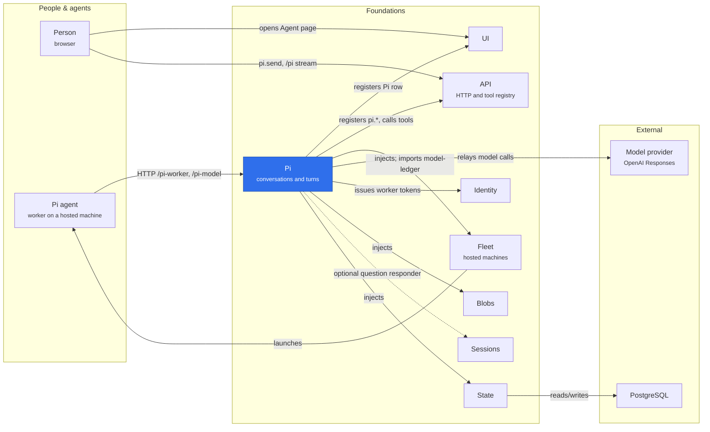

# @merv/pi

Pi is the agent a person talks to on the Agent page. Each conversation is private to its person and acts in the project with exactly that person's permissions, which every call it makes runs under; it is never asked for approval (founder, 2026-10-20), and what only the person may do (their credentials) no conversation is offered. Turns run on a hosted machine that Pi rents through Fleet. The worker there holds no model key: it takes its turns from `/pi-worker` and reaches the model through Pi's relay at `/pi-model`. The deployment composes Pi only when `MERV_PI_ENABLED` is set (see `deploy/render-config.mjs`).

## Where it sits

Pi sits between the person and a machine it rents from Fleet. A sent message becomes a turn that the worker claims from `/pi-worker`; the worker's model calls go through Pi's relay, and the tools it chooses run on the server through the tool registry as the person who sent the turn.

## Surface

- `@merv/pi`: provides `pi`; injects `state`, `scope`, `fleet`, `tools` and `blobs`, and registers as Fleet's `pi-host` owner. When `sessions` is present, an optional injection registers Pi as its question responder.
- `@merv/pi/tools`: `pi.create`, `pi.list`, `pi.snapshot`, `pi.prompt`, `pi.send`, `pi.voice`, `pi.screen`, `pi.warm`, `pi.stop`, `pi.model.set`, `pi.machine.set` and `pi.machine.stop`; and `screen.look` and `screen.show`, which only the agent calls: to see the person's screen (or, with `at`, a record or page they are not on, which their page draws out of sight in a hidden frame of the app), and to put a record or a page on it (their page navigates as a link would, and its back returns them).
- `@merv/pi/api`: `/pi`, the conversation event stream; `/pi-worker`, the worker's routes, which only its registered `piw_` credential reaches; and `/pi-model`, a public mount whose relay authenticates its `pir_` bearer itself.
- `@merv/pi/ui`: the rail's Pi row at `/agent`, present wherever Pi is loaded.

## Trusted conversation roles

Server plugins may register a versioned role with `pi.registerProfile` and create an instance
with `pi.createProfiled`. Neither operation is exposed as a public Pi tool. A role declares fixed
instructions, a model and reasoning effort, an explicit tool list, request context, and an optional
per-call authorization hook. Its request binding and definition hash are retained with the
conversation. A changed or unloaded role cannot run old conversations.

The customer experiment interviewer uses `gpt-6-astra` at `medium`; that exact pair must be in
`MERV_PI_MODELS`. It cannot change model, use voice, switch machines, or use any tool outside its
profile. Request context replaces project context, and its allowed tools replace ordinary Pi's
tool list. The SDK worker already disables every native coding tool and loads only the server's
explicit custom tools. Ordinary conversations and worker-question investigations retain their
existing behavior.

## Worker questions

When Sessions is present, Pi investigates new worker questions in a separate conversation owned by the person who delegated the work (a service's voucher identifies that person). It uses the ordinary Pi tools and authority; its turn is told not to merge, change budgets or turn dispatch off because a worker asked, and to say so with `needs_you`. No restricted investigator role is introduced. Pi creates and binds the conversation before sending its first turn; stable question-derived IDs make repeated delivery safe.

Pi ends with `session.question.resolve`: `answered` includes a repair and its verification; `needs_you` includes an investigation that failed. On escalation the person continues the same conversation at `/agent?conversation=<id>`. Pi can answer the original question after that exchange. A direct human answer always remains available in the worker's thread.

Sessions owns the durable question, its blocker, exact revision checks, accepted answer and dispatch resumption. Pi owns the investigation, its prompt and conversation. Sessions has no Pi dependency or knowledge of research concepts. Its existing upkeep checks only due investigations in bounded batches every full pass (normally 30 seconds), with a 15-minute investigation deadline; failure, an ended turn without a resolution, or responder unload restores human attention. Pi is optional: without it, new questions go directly to the person. A restart inspects an attached conversation; an interrupted launch that never sent its turn falls back to the person rather than leaving a hidden question.
