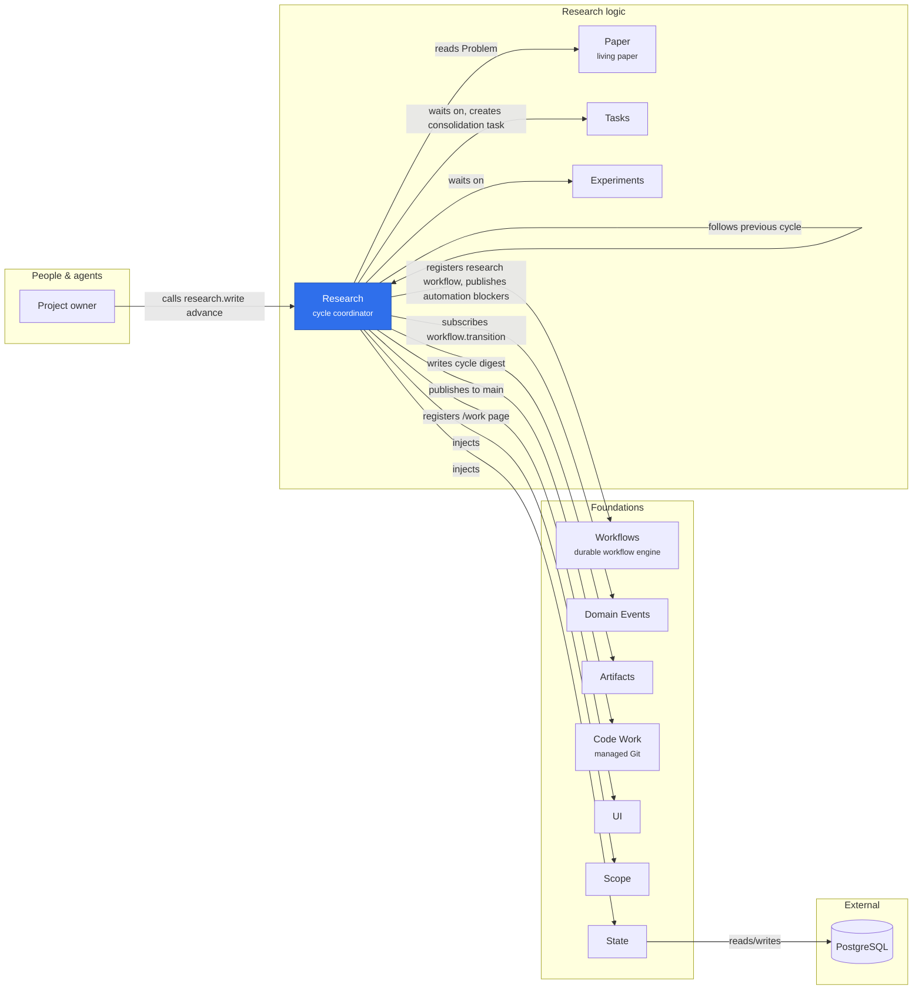

# @merv/research

Personal-agent tools below use `{"action":"x","x":{...}}`.
Leased workers keep the alias names and inputs granted by their pinned workflows.
See the [tool overview](../../README.md#agent-tools).

Research coordinates the outer research cycle over work that other plugins own. A cycle (`research@7`) moves through defining, researching, consolidating and complete, or ends abandoned or failed. It pins the project definition from the paper's Problem when it leaves defining, waits for its selected tasks and experiments to end (failed and abandoned work counts as an outcome), and completes. When Code hosts the project and accepted code is missing from main, it first injects one consolidation task, an ordinary Git task, and completes once that is accepted and published to main. A cycle may follow one ended cycle (`previousCycleId`), whose digest it reads. Research launches no workers. See [Research coordinator](../../docs/RESEARCH.md) and [continuous research](../../docs/CONTINUOUS_RESEARCH.md).

## Where it sits

Research waits on tasks and experiments, each of which keeps its own workflow; it registers only `research`. Every plugin it points to is required, and in automatic mode (`automatic: true`) workflow events advance a cycle without the owner. It creates no successor cycles.

## Surface

- `@merv/research`: the `research` service. It registers `research@7` with Workflows and subscribes through Domain Events to workflow, code, paper and research events to advance automatic cycles. A cycle that ends writes its digest (`formatVersion: 2`) as an artifact.
- `@merv/research/tools`: `research.read` (list, get, lineage) and `research.write` (create, replan, advance, end). `advance` with `retryIntegration: true` retries after an unaccepted consolidation; a stale publication injects a successor task.
- `@merv/research/ui`: the `/work` page, framed by its cycle, and the `/research` cycles page. Its part of `ui.home`, which Home and the rail poll, is `research.home`: the open cycles, the newest that ended, and any ended cycle whose published blocker still asks somebody to move, so the poll does not grow with every cycle run.
