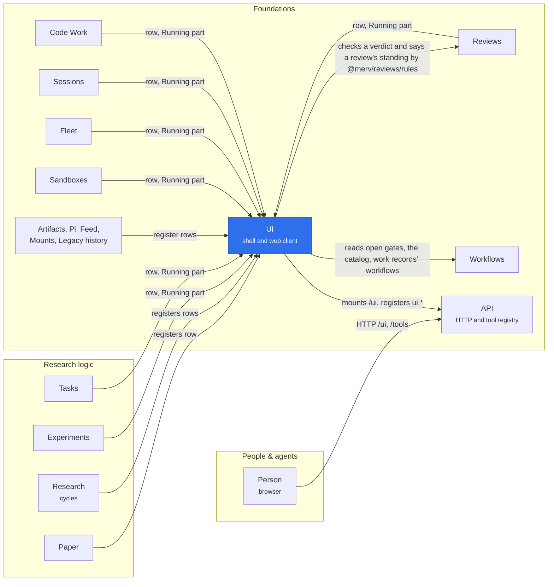

# @merv/ui

UI is the shell every other plugin draws into. Its server plugin keeps a registry of sidebar rows and Running-page parts that feature adapters register, mounts the built web client at `/ui`, and answers the page's own reads through `ui.*` tools. The web client (`web/`) is a React app that calls tools over the same `POST /tools/<name>` endpoint agents use and draws each row's page from its view `kind`. The plugin injects `api` and `tools`, provides `ui`, and is optional in the default composition.

## Where it sits

The server plugin owns no research or work records: research and foundation plugins inject `ui` from their optional `/ui` adapters to add rows and Running parts, and withdraw them when they unload. A row says in its owner's words what the shell would otherwise have to know: how Needs you asks for a move (`needs`) and what a state of its workflow means beyond its deployed definition (`states`: work not yet begun, and what crossing into a review gate says its producer did). The catalog says the rest: a gate is a state left through `review.write` (`submit`), and a state a deployed program works in reads as work under way. The web client is not yet free of research: it draws the research pages (Work, Tasks, Experiments, Cycles, Paper) from those plugins' `models`, and reads a few of their pure rules (`@merv/experiments/rules`, `@merv/code-work/blockers`). A person's browser loads the bundle from `/ui` and then reads `ui.shell`, `ui.home` and each row's own tools through the API.

## Surface

- `ctx.ui.register(row)`: a sidebar row with an id, group, order, path and view, and an optional live `status` and `read`, and for a row that lists a workflow's records, the owner's `states` words; disposing it removes the row at once.
- `ctx.ui.contribute(part)`: one owner's part of the Running page. An owner of work records declares their `workflows`, and a `work:` key's sidebar is asked only of the owner of its record's workflow.
- Tools: `ui.shell`, `ui.home`, `ui.running` and `ui.running_panel`, which no agent conversation is offered, and `ui.read`, which returns a row's data when the row has no domain tool of its own. No leased worker is listed any of them: it reads the records with their own tools.
- Route: `/ui`, public, serving the built bundle.
- `@merv/ui/manifest`: the types of the remote-row manifest a plugin (Fleet) describes its row with and the browser renders.
- Row: `settings`.

## The board, chat panel and first run (from merv-desktop)

merv-desktop's UI was moved in as UI modules of this package, not as packages of their own: they are browser code with no server side, and every `packages/*` entry here is a Cordis plugin the plugin map draws. The wire types both sides read are the one new package, `@merv/protocol` (`packages/protocol`), because the board plugin's server code reads them too.

- `web/panel/`: merv-desktop's shared panel parts (desk-ui): the chat thread and its quiet step trail, question and permission cards answered with worded buttons, the hand-off card, marks, agent and job cards, and the job page. They ask whoever provides `DeskCalls` (`panel/desk-calls.ts`) and never a transport of their own; Merv.app's local transport was left out, and `panel/desk-window.d.ts` only types the Mac app's window bridge, which Merv never sets.
- `web/board-app/`: the pieces of runmerv.com's board app Merv uses, with Merv's adapters where they read the Mac: `thread-data.ts` (the project's agent threads as the stream the thread draws, the Agent's tool calls and their answers as its trail, answers sent to `/sessions/threads/:id/messages`), `agent-question.tsx` (an agent's question answered with its worded buttons on Home's Needs you), `sessions.ts` (no devices), `open-session.ts` (opens a thread on Agents), `held.ts` (hand-offs wait for Approve; cloud runs never send themselves), `merv-panel.tsx` (the side panel and the Agent page), `first-run.tsx` and `welcome.tsx` (one card: "What do you want to learn?").
- `web/views/board*.tsx`, `pi*.ts(x)`, `voice-*`: the board and the Agent's conversation, merged with runmerv.com's: link, page and browser cards, the hand-off, replay and subtitles. Agent sessions (`views/agent-live.tsx`) draw their steps with the same trail.

Left out: the Mac's own shell, desk-server and session pairing (the voice talks to Merv only), the phone view, the landing and download pages, and the board's marks on Mac hand-offs, which read the Mac's units. One implementation of each shared helper remains: `useDismiss` (`panel/use-dismiss.ts`), the theme the page wears (`theme.ts`) and Mermaid (`mermaid.tsx`).
